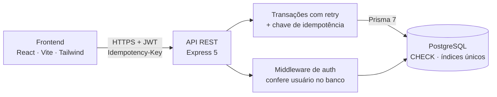

<div align="center">

# ERP Full-Stack

**Sistema de gestão comercial: clientes, produtos, estoque, vendas e dashboard, com estoque consistente sob concorrência.**

[](https://github.com/DeividiLuccasdev/erp-fullstack/actions/workflows/ci.yml)


[**Aplicação online**](https://erp-fullstack-frontend.onrender.com) · [API](https://erp-fullstack-api-deividi.onrender.com) · [Portfólio](https://portfolio-deividi.vercel.app/)

</div>

> **Acesso de demonstração** · E-mail: `demo@example.com` · Senha: `Demo@2026`
>
> Perfil `OPERADOR`: acessa dashboard, clientes, produtos, estoque e vendas; cadastro de usuários e exclusões ficam com o `ADMIN`.

> Projeto de portfólio. A aplicação usa o plano gratuito do Render, que "adormece" o servidor após 15 minutos sem uso: **o primeiro acesso pode demorar de 30 a 60 segundos**. Depois que ele acorda, tudo responde normalmente.

## Sobre

O ERP Full-Stack cobre o ciclo comercial de uma pequena empresa: cadastro de clientes e produtos, entrada e saída de estoque, pedidos de venda e um dashboard com os números do negócio. Frontend em React, API REST em Node.js com Express e Prisma, banco PostgreSQL.

O foco está no que costuma quebrar num sistema desses em uso real: **duplo clique, retry de rede e vendas simultâneas**. O estoque nunca fica negativo, um pedido não é finalizado duas vezes e a mesma ação repetida não aplica o efeito de novo. Esses cenários são testados contra um PostgreSQL de verdade no CI.

## Funcionalidades

| | |
| --- | --- |
| **Autenticação** | Login com e-mail e senha, JWT, senhas com hash bcrypt, perfis `ADMIN` e `OPERADOR`. Usuário desativado ou com perfil alterado perde o acesso na hora. |
| **Clientes** | Cadastro, listagem, consulta, edição e exclusão lógica; CPF único; controle de ativos e inativos. |
| **Produtos** | Código único, preço, estoque atual e mínimo. Produto com histórico é desativado em vez de apagado. |
| **Estoque** | Entradas e saídas com validação de saldo, histórico de movimentações com o usuário responsável e alerta de estoque baixo. |
| **Vendas e pedidos** | Pedido com cliente opcional, itens, subtotal e total calculados, finalização com baixa automática de estoque e cancelamento. |
| **Dashboard** | Clientes, produtos, pedidos abertos, vendas finalizadas, cancelamentos, faturamento, estoque baixo e últimas vendas. |
| **Controle de acesso** | Cadastro de usuários, exclusão e reativação de clientes e produtos são exclusivos do `ADMIN`. A conta de demonstração é protegida contra alterações. |
| **Interface responsiva** | Menu lateral que vira gaveta no celular. |

## Arquitetura



Em produção, o frontend é um Static Site no Render, a API roda como Web Service Docker no Render e o banco é um PostgreSQL no Neon. → [deploy e CI](docs/deploy.md)

## Decisões técnicas

- **Baixa de estoque num único `UPDATE` condicional.** A saída só acontece se `estoque >= quantidade`, sem ler e depois escrever. Duas saídas simultâneas não passam ambas pela conferência, e não é preciso travar a tabela.
- **Finalização trava o pedido antes de ler os itens.** O status muda de `ABERTO` para `FINALIZADO` primeiro; os itens são lidos depois, na mesma transação. Assim, finalizações repetidas recebem 409 e um item adicionado durante a finalização ou entra na baixa ou é recusado.
- **Baixa em ordem fixa de produto.** Vendas com os mesmos produtos em ordens diferentes travam as linhas na mesma ordem e não entram em deadlock. Se o PostgreSQL ainda assim desfizer a transação por conflito, ela é repetida até 3 vezes.
- **Idempotência gravada junto com o efeito.** O cabeçalho `Idempotency-Key` é salvo na mesma transação da operação, com índice único por usuário. Repetição devolve a resposta original; mesma chave com outro corpo responde 422; falha não consome a chave. O frontend gera uma chave por ação.
- **Invariantes no banco, não só no código.** `CHECK` impede estoque, preço e estoque mínimo negativos e quantidades zeradas. Duplicidade de código, CPF e e-mail é decidida pelo índice único (409), inclusive em cadastros simultâneos.
- **Saldo sempre rastreável.** O estoque inicial também vira movimentação e editar o produto não altera o saldo, então o estoque é sempre a soma das entradas menos as saídas.
- **Perfil lido do banco a cada requisição.** O token vale 8 horas, mas desativar um usuário ou trocar o perfil tem efeito imediato.

→ [concorrência e idempotência em detalhe](docs/concorrencia.md)

## Stack

| Camada | Tecnologias |
| --- | --- |
| Frontend | React 19, TypeScript, Vite, Tailwind CSS 4, Lucide React, Fetch API |
| Backend | Node.js 24, TypeScript, Express 5, JWT (jsonwebtoken), bcryptjs |
| Dados | PostgreSQL, Prisma ORM 7 (adapter `pg`), Neon em produção |
| Testes | Vitest, Supertest |
| Infra | Docker, Docker Compose, Nginx (frontend), GitHub Actions, Render |

## Como rodar

Pré-requisitos: Node.js 24 e um banco PostgreSQL. Crie `backend/.env` com `DATABASE_URL` e `JWT_SECRET` ([todas as variáveis](docs/execucao-local.md#variáveis-de-ambiente)).

```bash
git clone https://github.com/DeividiLuccasdev/erp-fullstack.git
cd erp-fullstack/backend
npm install
npx prisma generate
npx prisma migrate deploy
npm run criar-admin -- --email voce@exemplo.com --nome "Seu Nome"
npm run dev
```

O `criar-admin` pede a senha no terminal; não há cadastro público de usuários. API em http://localhost:3000.

Em outro terminal:

```bash
cd frontend
npm install
npm run dev
```

Frontend em http://localhost:5173. Para usar Docker Compose (frontend em `:8080`, backend em `:3000`), veja a [execução local](docs/execucao-local.md#docker).

## Testes

```bash
cd backend
npx prisma migrate deploy
npm test
```

36 testes de integração (Vitest + Supertest) chamam a API contra um PostgreSQL real. Use um banco **de teste**: os testes apagam as tabelas, e por isso só rodam se o nome do banco contiver `test` ou `ci`.

Os cenários cobertos incluem:

- 10 saídas simultâneas de 1 unidade com estoque 5: exatamente 5 passam e o saldo fica 0
- 5 finalizações simultâneas do mesmo pedido: uma 200, quatro 409, uma única baixa
- item adicionado durante a finalização e pedidos `[A,B]` e `[B,A]` finalizados ao mesmo tempo sem deadlock
- mesma `Idempotency-Key` repetida, enviada em paralelo, com outro corpo (422) e após falha
- CPF e código duplicados em paralelo (409) e `CHECK` impedindo estoque negativo fora da API
- cálculo em `Decimal` (0,10 × 3 = 0,30)

O CI (GitHub Actions) valida o TypeScript, aplica as migrations e roda a suíte num serviço PostgreSQL 16 a cada push e pull request para `main`, além do build do frontend. → [detalhes do CI](docs/deploy.md#integração-contínua)

## Estrutura

```text
backend/
├── prisma/
│   ├── migrations/       # histórico do schema, incluindo CHECKs e idempotência
│   └── schema.prisma
├── src/
│   ├── config/           # cliente Prisma
│   ├── lib/              # erros HTTP, transação com retry, idempotência e conta demo
│   ├── middlewares/      # autenticação e autorização por perfil
│   ├── routes/           # auth, usuários, clientes, produtos, estoque, pedidos, dashboard
│   ├── scripts/          # criar-admin
│   ├── app.ts            # Express, rotas e tratamento de erros
│   └── server.ts
├── tests/                # testes de integração e helpers
└── Dockerfile
frontend/
├── src/
│   ├── pages/            # Clientes, Produtos, Estoque, Vendas
│   ├── api.ts            # cliente HTTP e geração de Idempotency-Key
│   └── App.tsx           # login, menu e dashboard
└── Dockerfile            # build com Node, servido por Nginx
docs/                     # documentação detalhada
docker-compose.yml
```

## Documentação

- [API REST](docs/api.md): todas as rotas, permissões, códigos de resposta e `Idempotency-Key`
- [Concorrência e idempotência](docs/concorrencia.md): como cada corrida é tratada e onde está no código
- [Execução local](docs/execucao-local.md): variáveis de ambiente, primeiro administrador e Docker
- [Deploy e CI](docs/deploy.md): Render, Neon e GitHub Actions

## Limitações conhecidas

- O frontend não tem testes automatizados; no CI ele passa apenas pelo build.
- As chaves de idempotência não expiram: não há rotina de limpeza da tabela `ChaveIdempotencia`.
- O CORS aceita qualquer origem.
- Não há recuperação de senha, multiempresa nem emissão fiscal.
- A demo no plano gratuito do Render tem a latência de primeiro acesso descrita acima.
- Os dados da demonstração são compartilhados: qualquer visitante pode alterá-los. A conta de demonstração é restaurada (ativa, perfil e senha) a cada deploy.

## Roadmap

- [ ] Testes do frontend
- [ ] Expiração e limpeza das chaves de idempotência
- [ ] CORS restrito à origem do frontend
- [ ] Recuperação de senha
- [ ] Relatórios de vendas por período

## Autor

**Deividi Tiago Luccas** · Desenvolvedor Full-Stack · [Portfólio](https://portfolio-deividi.vercel.app/) · [GitHub](https://github.com/DeividiLuccasdev) · [LinkedIn](https://www.linkedin.com/in/deividi-luccas-0ab589227)
